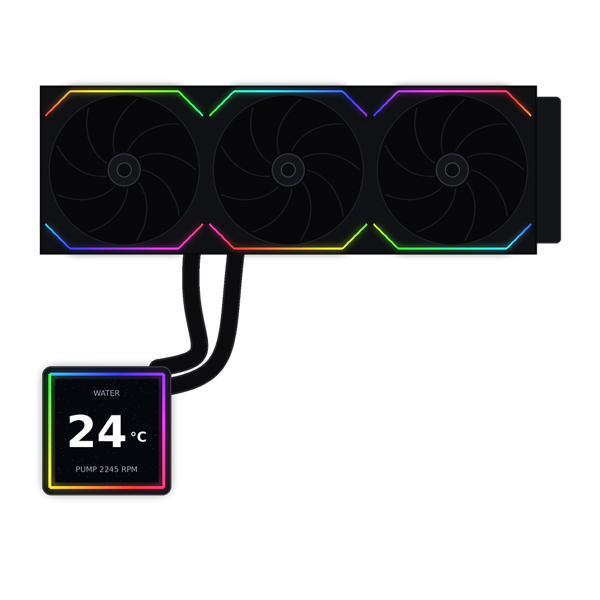

# SignalRGB × Lian Li HydroShift II + UNI FAN TL Wireless

Control the lighting of the **Lian Li HydroShift II** (wireless) and **UNI FAN TL Wireless** fans from **SignalRGB**, live, together with the rest of your setup, or store a **smooth effect on the devices** that keeps playing on its own. Drive the **pump and fan speeds from SignalRGB fan curves**, and show your **CPU / GPU temperature and load, coolant temperature or pump speed on the pump's LCD**.

<p align="center"></p>

> 🇯🇴 Arabic guide: [README.ar.md](README.ar.md)

| Status | |
|---|---|
| ✅ Works | HydroShift II LCD-S pump ring + 3× UNI FAN TL Wireless, live from the SignalRGB canvas |
| 🧪 Should work, untested | HydroShift II LCD-C, other UNI FAN Wireless fans (SL V3, SL-INF, CL, TL V3, SL V4, P28 V2) |
| ✅ 1.2 | LCD shows CPU/GPU temperature + load (built-in sensor themes), via a small helper |
| ✅ 1.3 | Pump + fan speed curves on SignalRGB's Fan Control page, coolant temperature sensor |
| ✅ 1.4 | **Automatic setup** (no values to copy) and **stored hardware effects** (smooth 20 fps, keep running after SignalRGB closes) |
| ✅ New in 1.5 | **Pick what the LCD shows** in each of its four value spots, including **coolant temperature** and **pump speed**; settings sorted into sections (`LCD ·`, `Fans & Pump ·`, `Advanced ·`) |
| ❌ Not possible | Custom images/videos or SignalRGB LCD themes on the LCD: over the wireless link the screen only takes a startup image (see [docs/PROTOCOL.md](docs/PROTOCOL.md)) |

> ⚠️ Community project. Not affiliated with Lian Li or WhirlwindFX. Use at your own risk.

---

## Before you start

- **L-Connect 3 must be fully closed**, including its background service. Both apps need the same USB dongles, and only one can use them at a time.
- While L-Connect is closed, L-Connect's fan and pump curves stop. Either keep the last speeds L-Connect set (default), or let SignalRGB run the curves with [Fan & Pump Control](#fan--pump-control). The LCD can show temperatures with the [LCD sensor screen](#lcd-sensor-screen-cpu--gpu-temperature).
- In L-Connect, turn **off Motherboard RGB Sync** for your devices.
- Wireless fans have no cable to the motherboard: they only spin when something talks to the dongle. With L-Connect stopped they stand still from power-on until SignalRGB starts after sign-in. The [Fan Handoff](#fans-spin-from-boot-fan-handoff) fixes that.

### Stop L-Connect permanently (one time)

1. In L-Connect 3, set your fan and pump speeds, then quit it from the tray icon.
2. Press `Win + R`, type `services.msc`, press Enter.
3. Open **L-Connect Service**, set **Startup type** to **Manual**, click **Stop**, then **OK**.

To go back to L-Connect at any time, start that service again and open L-Connect 3.

---

## Install (SignalRGB Add-on)

1. Open SignalRGB → **Settings** → **Add-ons**.
2. Click **Add Add-on** and paste this repository's URL:
   ```
   https://github.com/ShkourBashtawi/SignalRGB-HydroShift-II-TL-Wireless
   ```
3. Restart SignalRGB.

Two new devices appear under **Devices**:

| Device | What it does |
|---|---|
| **Lian Li Wireless RX (Finder)** | Reads your wireless devices and prints the values you need. No LEDs. |
| **Lian Li HydroShift II (Wireless)** | Sends the lighting to the pump and fans. |

---

## Setup (automatic)

Enable both devices. That's it: the **RX Finder** reads which pump and fans are bound to your dongle, and **Lian Li HydroShift II (Wireless)** picks them up by itself (MACs, RX slots, fan count, LEDs per fan, channel). Its console shows:

```
Auto setup: pump e7:f5:f3:e5:66:e1, fans 81:0c:73:e5:66:e1 (3x UNI FAN TL Wireless, 26 LEDs each).
```

**Test:** set **Lighting Mode** to **Forced** and pick a color. The pump and fans change within a second. Then set it back to **Canvas**.

### Pinning a specific device (optional)

If you have more than one pump or fan group on the dongle, open the Finder's console (`>_` icon, top right). It prints the values in the same names and order as the HydroShift II settings:

```
==================================================
 FOUND ON THIS DONGLE
 The HydroShift device picks these up by itself (Auto setup).
 Copy them into its settings only to pin a specific device.
==================================================
  Pump MAC ........... e7:f5:f3:e5:66:e1
  Pump RX Slot ....... 2
  Fans MAC ........... 81:0c:73:e5:66:e1
  Fans RX Slot ....... 1
  Fan Count .......... 3
  LEDs per Fan ....... 26
  Device Channel ..... 39
  TX Master Channel .. Auto
==================================================
```

Anything left at its default (`00:00:00:00:00:00`, `Broadcast`, `Auto`) stays automatic. Settings from older versions keep working as they are.

---

## Hardware effects (stored on the devices)

Instead of streaming every frame over the radio, the plugin can upload a whole animation once. The pump and fans then play it by themselves at up to 20 frames per second: perfectly smooth, no radio traffic, and it **keeps playing after SignalRGB closes**.

| Setting | |
|---|---|
| **Lighting Mode** | `Hardware Effect` |
| **Hardware Effect** | `Rainbow Wave`, `Rainbow Spin`, `Color Cycle`, `Breathing`, `Spinner`, `Static`, or **`Canvas Loop`** (records 4 seconds of whatever SignalRGB effect is running and loops it with a crossfade) |
| Effect Speed | 1–10 |
| Effect Color | For Breathing, Spinner and Static |
| **When SignalRGB Closes** | `Shutdown Color` (default) or `Hardware Effect`: store the effect on the way out, so your PC keeps its lighting with SignalRGB closed |

Each device reports the effect it is playing, so the RX Finder confirms every upload (`Hardware effect is playing on the fans (confirmed by the RX Finder)`) and the plugin re-sends it if a device missed it or was power-cycled.

---

## LCD sensor screen (CPU / GPU temperature)

The HydroShift II LCD has built-in "sensor" themes that draw the numbers the PC sends it. SignalRGB can't read temperatures by itself, so a tiny helper reads them and hands them to the plugin over `127.0.0.1` (your PC only, nothing leaves it).

```
HydroShiftSensors.ps1  --UDP 127.0.0.1:51870-->  HydroShift II plugin  --wireless-->  pump LCD
LibreHardwareMonitor (optional, for CPU temp)          ^
                                         RX Finder ----┘ (confirms the screen switch, watches the pump)
```

### 1. Install the helper (one time)

From this repository (or the add-on folder), open the `helper` folder:

| File | What it does |
|---|---|
| `Test-Sensors.bat` | Shows live readings in a window. Nothing is installed. Try this first. |
| `Install-Sensors-Helper.bat` | Installs the helper as a hidden task that starts when you sign in. Asks for admin. |
| `Uninstall-Sensors-Helper.bat` | Removes it. |

What it reads without extra software:

| Value | Source |
|---|---|
| CPU load | Windows performance counters |
| GPU load | Windows GPU counters (any GPU), or `nvidia-smi` |
| GPU temperature | `nvidia-smi` (NVIDIA cards) |
| CPU temperature | **needs LibreHardwareMonitor** (below) |

**For CPU temperature (and AMD/Intel GPU temperature):** install [LibreHardwareMonitor](https://github.com/LibreHardwareMonitor/LibreHardwareMonitor), then in it enable **Options → Remote Web Server → Run** (port 8085) and **Options → Run On Windows Startup**. The helper finds it automatically and uses it for every value.

### 2. Turn the screen on

Open **Lian Li HydroShift II (Wireless)** → settings:

| Setting | |
|---|---|
| **LCD · Screen** | `CPU/GPU Sensors` (default `Off (don't touch)`: nothing is sent to the screen) |
| LCD · Theme | `1`–`13`, the built-in sensor layouts |
| **LCD · Value 1–4** | What each of the theme's four value spots shows: `CPU Temperature`, `CPU Load`, `GPU Temperature`, `GPU Load`, `Coolant Temperature`, `Pump Speed (%)` or `Off`. Defaults are the theme's own CPU temp / CPU load / GPU temp / GPU load. The text label next to a spot comes from the theme and stays the same. Pump speed is a percentage because the screen only shows 0–99. |
| LCD · Brightness / Rotation / Page Time | Page Time = seconds per page on themes that cycle |
| LCD · Label / Value / Unit Color | Text colors |
| **Fans & Pump · Pump Speed (with LCD on)** | The screen data also carries the pump speed. Default `3200 rpm (max)`. |
| Fans & Pump · Pump Head | `LCD-S (square)` or `LCD-C (round)` |

Example, coolant and pump instead of the GPU: set **LCD · Value 3** to `Coolant Temperature` and **LCD · Value 4** to `Pump Speed (%)`. The theme still writes its own label (for example "GPU") next to those spots, so pick a theme whose layout suits you.

Keep the **RX Finder** device enabled: the plugin uses it to confirm the screen switched, to watch the pump, and it is where the coolant temperature and pump speed come from.

> ⚠️ **Pump safety.** The same wireless packet sets the LCD *and* the pump speed. The plugin sends the speed you pick (default: maximum, the same as L-Connect's default) and warns in the device page and console if the pump reports under 1000 rpm. On the first run, check the Finder console line `Status pump … rpm`.

The plugin console prints a status line every 30 seconds, for example:

```
LCD  CPU 52°C 18% | GPU 44°C 6% | helper: LibreHardwareMonitor | pump 3180 rpm, coolant 35 °C | theme on
```

`--` means that value isn't available (for example CPU temperature without LibreHardwareMonitor).

---

## Fan & Pump Control

SignalRGB can run the pump and every fan from curves on its **Fan Control** page, like L-Connect did.

1. Open **Lian Li HydroShift II (Wireless)** → settings → **Fans & Pump · Control** → `SignalRGB Fan Control`.
2. Keep the **RX Finder** device enabled (it reports RPM, coolant temperature and which channel each device listens on).
3. **Pump**, **Fan 1-3** and a **Coolant** temperature sensor appear on SignalRGB's Fan Control page. Set a curve for each.

| | How it works |
|---|---|
| Fans | 0-100 % curve → PWM duty, sent once a second (the fans fall back to their own default if the host goes quiet). Floor 11 % for TL fans. A curve at 0 % runs the fan at that minimum unless **Fans & Pump · Fans at 0%** is `Stop the fans`. |
| Pump | 0-100 % curve → 1600-3200 rpm (LCD-S) or 1600-2500 rpm (LCD-C), sent inside the LCD data packet. Starts at full speed until the first curve value. |
| Safety | A missing or in-between value keeps the last speed instead of stopping; small changes are averaged over 10 samples. Turning Fan Control off for the device in SignalRGB hands the fans back instead of stopping them. Fans without an RX slot are never sent speeds. |
| Turning it off | The fans get their previous duty and channel back, and the pump goes back to **Pump Speed**. |

> ℹ️ The pump speed travels in the same packet as the LCD settings, so while Fan & Pump Control is on the LCD shows the **LCD · Theme** you picked (with values only when **LCD · Screen** is `CPU/GPU Sensors`).
>
> ℹ️ The first speed command makes the fans switch to the TX's master channel. The plugin follows each device on the channel the Finder reports, and moves the fans back to **Advanced · Device Channel** when you turn the feature off.

---

## Fans spin from boot (Fan Handoff)

SignalRGB only starts after you sign in to Windows, and the wireless fans don't spin until something talks to the dongle. The Fan Handoff lets **L-Connect Service** run the fans from power-on, on the curves you saved in L-Connect, and hands the dongle to SignalRGB as soon as it is running.

1. Open L-Connect 3 once, set your fan and pump speeds, then quit it from the tray.
2. In the `helper` folder run **`Install-Fan-Handoff.bat`** (asks for admin).
3. Restart Windows. The fans spin before you sign in, and SignalRGB takes over a few seconds after it opens.

| | What it does |
|---|---|
| L-Connect Service | Set to **Automatic**: runs the fans from boot |
| L-Connect Service Watcher | Stays **Disabled** (it would restart the service) |
| Task at sign-in | Waits for SignalRGB, then stops L-Connect Service. If SignalRGB doesn't pick the devices up within 30 s it restarts SignalRGB once. If SignalRGB never starts, the service keeps running the fans. |

Log: `%LOCALAPPDATA%\HydroShiftFanHandoff\handoff.log`. To undo, run **`Uninstall-Fan-Handoff.bat`** (L-Connect Service goes back to Disabled).

> Between sign-in and the handoff you see L-Connect's lighting for a few seconds.

---

## Tuning

| Setting | Use it when |
|---|---|
| Advanced · Updates per Second | The animation stutters: try `15` or `18` (max). Flicker: try `10`. |
| Ring Rotation | The effect looks rotated on the rings |
| Reverse Ring Direction | Spirals or rainbows spin the wrong way |
| Skip the pump or the fans | Set that RX Slot to a slot nothing uses, or disable the device. (`00:00:00:00:00:00` now means *automatic*.) |

**About smoothness:** Lian Li's wireless system was built to receive an effect and play it on its own. Streaming every frame over the radio is limited to roughly **15–18 updates per second** at best. Slow and medium effects look great; very fast ones can look slightly choppy. For perfectly smooth motion use a [hardware effect](#hardware-effects-stored-on-the-devices).

---

## Troubleshooting

| Problem | Fix |
|---|---|
| The two devices don't appear | `L-Connect-Service.exe` is still running. Stop it (see above) and restart SignalRGB. |
| Finder shows "No wireless devices" | The devices must be powered and already bound to this dongle. Bind them once in L-Connect, then close it. |
| "Wireless TX did not answer" | Close L-Connect completely, restart SignalRGB. |
| Colors never change | Keep the RX Finder enabled (auto setup and channel following need it). If you pinned values by hand, re-check them against the Finder. |
| "Waiting for the RX Finder" | Enable the **Lian Li Wireless RX (Finder)** device. |
| Hardware effect "not confirmed" | Check the Finder is enabled and the devices are in range; the plugin retries by itself. |
| Fan & Pump Control does nothing | Check the device's **Cooling** tab: Fan control must be enabled for it in SignalRGB. The console says so when it isn't. |
| Fans run at 50 % after closing SignalRGB | That's the fans' own fallback when the host goes quiet. Reopen L-Connect to set them, or keep SignalRGB running. |
| It stops working after a Windows restart | The L-Connect service started again and nothing stopped it. Set its Startup type to Manual, or use the [Fan Handoff](#fans-spin-from-boot-fan-handoff), which stops it for you. |
| Fans don't spin until SignalRGB opens | Expected without L-Connect: wireless fans need the dongle. Install the [Fan Handoff](#fans-spin-from-boot-fan-handoff). |
| Wrong colors on part of a fan | Check **Advanced · Fan Count** and **Advanced · LEDs per Fan** match the Finder. |
| LCD shows `--` | The helper isn't running (run `Test-Sensors.bat`), or that value needs LibreHardwareMonitor. |
| Coolant or pump speed shows `--` | Enable the **RX Finder**: those two values come from it. |
| LCD doesn't switch to the sensor theme | Keep the RX Finder enabled; check the console for `LCD switched to the sensor theme`. |
| "Pump RPM low" warning | Set **LCD · Screen** to Off and reopen L-Connect 3 to restore the pump. Please open an issue with the console log. |

---

## How it works (short)

- The **TX dongle** (`0416:8040`) sends commands over the air; the **RX dongle** (`0416:8041`) reports the device list.
- Every live update is a one-frame **RF_SET_RGB** upload (a hardware effect is the same command with up to a few hundred frames and a frame interval): colors are compressed with **tinyuz**, split into 240-byte RF frames and sent as 64-byte USB packets.
- A 1-second **clock heartbeat** keeps the fans out of their fallback mode.
- LCD: one **RF_AIO_SWITCH_WIRELESS** command (acknowledged through the RX device list), then a 32-byte **RF_AIO_PARAMS** block once a second with the sensor values, theme, colors and pump speed.
- Fans: **RF_PWM_CMD** with four duties, once a second.

Details: [docs/PROTOCOL.md](docs/PROTOCOL.md)

## Verified

- Hardware: HydroShift II LCD-S 360 TL + 3× UNI FAN TL Wireless, L-Wireless TX/RX V1.6, SignalRGB 2.5.79 beta, Windows 11.
- Tests (`test/run_all.sh`): the compressor round-trips 86 inputs through the **official tinyuz decoder**; RF packets and effect indexes are byte-identical to the reference Rust implementation; the parser is tested on a real dongle reply.
- LCD tests: theme-switch frames, sequence numbers and both pump-speed curves (4,000+ values) match the Rust implementation; an end-to-end simulation runs both plugins and the helper protocol against a fake AIO (switch + ack, values, stale helper, pump watchdog, LCD off), and each value spot with every source (coolant, pump %, Off).
- Fan tests: PWM frames for 7 fan families × 7 duty sets are byte-identical to Rust; a simulation covers curves → PWM, pump curve → timer, RPM/coolant publishing, the channel move, hand-back, and SignalRGB fan control being disabled.
- Auto-setup tests: with every setting at its default, both plugins find the pump and 3 TL fans, address them on the right slots, and ride out a pump that misses replies without flicker. Hardware effects: every built-in effect decodes through the official tinyuz decoder to frames × LEDs × RGB; a simulation covers upload, Finder confirmation, retry, re-upload after a power cycle, Canvas Loop and storing on exit.
- Fan Handoff tested on the hardware above: fans spin from power-on and SignalRGB takes over after sign-in.
- Live on the hardware above: fans followed the curve (PWM 194 → ~1966 rpm), pump followed (2849 → 2912 rpm), and hand-back restored pump 3180 rpm and fan channel 39. Hardware effects played on the pump and fans and were confirmed through the RX Finder; the LCD showed CPU/GPU values from LibreHardwareMonitor. 1.5 ran on SignalRGB 2.5.80 as a local plugin: the LCD switched to the sensor theme and took the new value spots.

## For developers

```bash
python3 build.py        # rebuild the two plugin files from src/ (needs Pillow: embeds assets/*.png as the device images)
python3 tools/make_images.py   # redraw assets/*.png
./test/run_all.sh       # needs node, gcc/g++, and tinyuz + HDiffPatch in ./vendor
```

### Try a change in SignalRGB without publishing

```bat
dev\Deploy-Local.bat
```

Builds the plugins, copies them into SignalRGB's own user plugin folder (read from the registry, `HKCU\Software\WhirlwindFX\SignalRgb` → `UserDirectory`; it is often on OneDrive) and restarts SignalRGB. Remove the GitHub add-on first, or both copies claim the dongle. `dev\Remove-Local.bat` deletes the local copies again and restarts SignalRGB; then re-add the add-on. SignalRGB's log (`%LOCALAPPDATA%\WhirlwindFX\SignalRgb\Logs`) says `Custom Plugin File Loaded` when the local copy is in use.

Edit `src/` (`core.cjs`, `*.tpl`), not the generated `.js` files at the root. Only the two root `.js` files use the `.js` extension, because SignalRGB loads every `.js` file in an add-on as a plugin.

## Credits

- Protocol: [sgtaziz/lian-li-linux](https://github.com/sgtaziz/lian-li-linux) (MIT)
- Compression format: [sisong/tinyuz](https://github.com/sisong/tinyuz) (MIT)

## License

[MIT](LICENSE)
